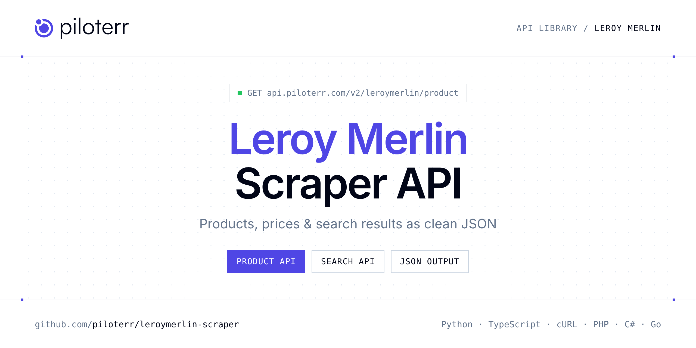

<p align="center">
  <a href="https://www.piloterr.com"></a>
</p>

# Leroy Merlin Scraper API

[](https://discord.gg/CFj3ph8aHU) [](https://app.piloterr.com) [](https://app.piloterr.com/openapi) [](LICENSE)

The **Piloterr Leroy Merlin Scraper API** lets you extract public data from Leroy Merlin as **clean, structured JSON** — no proxies, headless browsers or HTML parsing to maintain. Endpoints available in production:

- **Leroy Merlin Product API** — Live Leroy Merlin product detail for France and Romania from a URL or identifier: offers, currency, images, features and store context.
- **Leroy Merlin Search API** — Live Leroy Merlin search across France and Romania: title, URL, price, currency, brand, seller, rating and pagination.

Use it for price monitoring, assortment tracking, competitor analysis, product research or catalog enrichment.

| Endpoint | Path | Credits | What you get |
|---|---|---|---|
| [Leroy Merlin Product API](#leroy-merlin-product-api) | `/v2/leroymerlin/product` | 3 | Live Leroy Merlin product detail for France and Romania from a URL or identifier |
| [Leroy Merlin Search API](#leroy-merlin-search-api) | `/v2/leroymerlin/search` | 3 | Live Leroy Merlin search across France and Romania |

## Table of contents

- [How it works](#how-it-works)
- [Leroy Merlin Product API](#leroy-merlin-product-api)
- [Leroy Merlin Search API](#leroy-merlin-search-api)
- [Code examples in other languages](#code-examples-in-other-languages)
- [Practical use cases](#practical-use-cases)
- [Why Piloterr?](#why-piloterr)
- [FAQ](#faq)
- [Related scrapers](#related-scrapers)
- [Support](#support)

## How it works

1. **Create a free Piloterr account** and copy your API key from the [dashboard](https://app.piloterr.com).
2. **Send a `GET` (or `POST`) request** to `https://api.piloterr.com/v2/...` with the header `x-api-key: YOUR_API_KEY`.
3. **Receive structured JSON** — Piloterr handles rendering, proxies, retries and parsing.

```bash
export PILOTERR_API_KEY="your-api-key"
pip install requests        # Python
# TypeScript: Node.js 18+ (native fetch), run with `npx tsx file.ts`
```

> Every endpoint accepts both `GET` (query string) and `POST` (JSON body with the same fields).

## Leroy Merlin Product API

Live Leroy Merlin product detail for France and Romania from a URL or identifier: offers, currency, images, features and store context.

`GET | POST https://api.piloterr.com/v2/leroymerlin/product` · **3 credits per request** · [Full reference](https://app.piloterr.com/openapi)

### Request parameters

| Parameter | Type | Required | Description |
|---|---|---|---|
| `query` | string | ✅ | Full Leroy Merlin product URL, or an identifier (SKU / EAN / text). |
| `region` | string | — | Leroy Merlin country when `query` is a keyword or identifier (default: `fr`). Ignored when `query` is a full Leroy Merlin URL (country is detected from the domain). |
| `store_id` | string | — | Optional store id for local offer context (prices, stock, deliveries). Must exist for the active region. Returns `400` when unknown. |
| `return_page_source` | boolean | — | When set to `true`, returns the raw HTML of the product page instead of the parsed JSON payload. Useful for debugging or custom parsing. The response shape is `{"return": "<html>..."}`. Defaults to `false`. |

### Python example

```python
import json
import os
import requests

response = requests.get(
    "https://api.piloterr.com/v2/leroymerlin/product",
    headers={"x-api-key": os.environ["PILOTERR_API_KEY"]},
    params={
        "query": "https://www.leroymerlin.fr/produits/bobine-soudure-63378273.html",
    },
    timeout=120,
)
response.raise_for_status()
data = response.json()

print(json.dumps(data, indent=2, ensure_ascii=False)[:2000])
```

### TypeScript example

```typescript
type LeroyMerlinProduct = {
  sku?: string;
  url?: string;
  store?: {
    id?: string;
    slug?: string;
  };
  title?: string;
  images?: string[];
  rating?: number;
  region?: string;
  features?: {
    Forme?: string;
    Aspect?: string;
    Couleur?: string;
    "Largeur (en cm)"?: string;
    "Longueur (en cm)"?: string;
    "Epaisseur (en mm)"?: string;
    "Pays de fabrication"?: string;
    "Destination du carrelage"?: string;
    "Contenance de la bo\u00eete (en m\u00b2)"?: string;
    "Nombre de carreaux dans la bo\u00eete"?: string;
  };
  best_offer?: {
    price?: number;
    seller?: {
      id?: string;
      name?: string;
      type?: string;
    };
    currency?: string;
    available?: boolean;
    deliveries?: {
      time?: string;
      type?: string;
      price?: number;
      stock?: number;
      stock_status?: string;
    }[];
    offer_type?: string;
    price_excl_tax?: number;
  };
  breadcrumb?: {
    url?: string;
    name?: string;
    position?: number;
  }[];
  description?: string;
  marketing_tag?: string;
  reviews_count?: number;
  total_offer_count?: number;
  sellers_composition?: string;
};

const params = new URLSearchParams({
  "query": "https://www.leroymerlin.fr/produits/bobine-soudure-63378273.html",
});

const response = await fetch(`https://api.piloterr.com/v2/leroymerlin/product?${params}`, {
  headers: { "x-api-key": process.env.PILOTERR_API_KEY! },
});
if (!response.ok) throw new Error(`Piloterr error ${response.status}: ${await response.text()}`);

const data = (await response.json()) as LeroyMerlinProduct;

console.log(JSON.stringify(data, null, 2).slice(0, 2000));
```

<details>
<summary><b>POST variant</b></summary>

```http
POST https://api.piloterr.com/v2/leroymerlin/product
x-api-key: YOUR_API_KEY
Content-Type: application/json

{"query": "https://www.leroymerlin.fr/produits/bobine-soudure-63378273.html"}
```
</details>

### Output example

Example response from the API reference, abridged — real values depend on the page you scrape.

```json
{
  "sku": "82311569",
  "url": "https://www.leroymerlin.fr/produits/carrelage-mur-interieur-effet-zellige-blanc-casse-zellie-l-10-x-l-10-cm-x-ep-10-82311569.html",
  "store": {
    "id": "110",
    "slug": "balma-toulouse"
  },
  "title": "Carrelage mur intérieur effet zellige blanc cassé Zellie l.10 x L.10 cm x Ep.10",
  "images": [
    "https://media.adeo.com/media/1102654/media.jpg",
    "https://media.adeo.com/media/1034533/media.jpg"
  ],
  "rating": 4.37,
  "region": "fr",
  "features": {
    "Forme": "Carré",
    "Aspect": "Brillant",
    "Couleur": "Blanc cassé",
    "Largeur (en cm)": "10",
    "Longueur (en cm)": "10",
    "Epaisseur (en mm)": "10",
    "Pays de fabrication": "Italie",
    "Destination du carrelage": "Mur intérieur",
    "Contenance de la boîte (en m²)": "0.54",
    "Nombre de carreaux dans la boîte": "54"
  },
  "best_offer": {
    "price": 21.54,
    "seller": {
      "id": "example",
      "name": "example",
      "type": "example"
    },
    "currency": "EUR",
    "available": true,
    "deliveries": [
      {
        "time": "3 OPENING_DAY",
        "type": "relayDelivery",
        "price": 1.9,
        "stock": 2823,
        "stock_status": "ONSITE"
      },
      {
        "time": "5 OPENING_DAY",
        "type": "homeDelivery",
        "price": 4.9,
        "stock": 2823,
        "stock_status": "ONSITE"
      }
    ],
    "offer_type": "NEW",
    "price_excl_tax": 17.95
  },
  "breadcrumb": [
    {
      "url": "https://www.leroymerlin.fr/",
      "name": "Accueil",
      "position": 1
    },
    {
      "url": "https://www.leroymerlin.fr/produits/",
      "name": "Produits",
      "position": 2
    }
  ],
  "description": "Pour avoir un résultat aussi authentique que les zelliges du Maroc, nous vous conseillons de les poser sans croisillon. C'est l'effet irr…",
  "marketing_tag": "RESPONSIBLE_SECONDARY",
  "reviews_count": 282,
  "total_offer_count": 1,
  "sellers_composition": "1P_only"
}
```

### Response fields

| Field | Type | Description |
|---|---|---|
| `sku` | string |  |
| `url` | string |  |
| `store` | object |  |
| `store.id` | string |  |
| `store.slug` | string |  |
| `title` | string |  |
| `images` | string[] |  |
| `rating` | number |  |
| `region` | string |  |
| `features` | object |  |
| `features.Forme` | string |  |
| `features.Aspect` | string |  |
| `features.Couleur` | string |  |
| `features.Largeur (en cm)` | string |  |
| `features.Longueur (en cm)` | string |  |
| `features.Epaisseur (en mm)` | string |  |
| `features.Pays de fabrication` | string |  |
| `features.Destination du carrelage` | string |  |
| `features.Contenance de la boîte (en m²)` | string |  |
| `features.Nombre de carreaux dans la boîte` | string |  |
| `best_offer` | object |  |
| `best_offer.price` | number |  |
| `best_offer.seller` | object |  |
| `best_offer.currency` | string |  |
| `best_offer.available` | boolean |  |

## Leroy Merlin Search API

Live Leroy Merlin search across France and Romania: title, URL, price, currency, brand, seller, rating and pagination.

`GET | POST https://api.piloterr.com/v2/leroymerlin/search` · **3 credits per request** · [Full reference](https://app.piloterr.com/openapi)

### Request parameters

| Parameter | Type | Required | Description |
|---|---|---|---|
| `query` | string | ✅ | Search keyword, SKU/EAN, or full Leroy Merlin search URL. |
| `region` | string | — | Leroy Merlin country when `query` is a keyword or identifier (default: `fr`). Ignored when `query` is a full Leroy Merlin URL (country is detected from the domain). |
| `page` | number | — | 1-based page number for pagination. Defaults to `1` when omitted. Use the `pagination.total_pages` returned by a previous call to iterate. |
| `store_id` | string | — | Optional store id for local prices and availability. Must exist for the active region (`FR` stores with `region=fr`, `RO` stores with `region=ro`). Returns `400` when unknown. |
| `return_page_source` | boolean | — | When set to `true`, returns the raw HTML of the page instead of the parsed JSON payload. Useful for debugging or custom parsing. The response shape is `{"return": "<html>..."}`. Defaults to `false`. |

### Python example

```python
import json
import os
import requests

response = requests.get(
    "https://api.piloterr.com/v2/leroymerlin/search",
    headers={"x-api-key": os.environ["PILOTERR_API_KEY"]},
    params={
        "query": "perceuse",
    },
    timeout=120,
)
response.raise_for_status()
data = response.json()

print(json.dumps(data, indent=2, ensure_ascii=False)[:2000])
```

### TypeScript example

```typescript
type LeroyMerlinSearch = {
  total?: number;
  region?: string;
  results?: {
    sku?: string;
    url?: string;
    brand?: string;
    price?: number;
    title?: string;
    rating?: number;
    seller?: {
      name?: string;
      type?: string;
    };
    currency?: string;
    position?: number;
    is_sponsored?: boolean;
    price_excl_tax?: number;
    total_offer_count?: number;
  }[];
  pagination?: {
    has_next?: boolean;
    total_pages?: number;
    current_page?: number;
    has_previous?: boolean;
  };
};

const params = new URLSearchParams({
  "query": "perceuse",
});

const response = await fetch(`https://api.piloterr.com/v2/leroymerlin/search?${params}`, {
  headers: { "x-api-key": process.env.PILOTERR_API_KEY! },
});
if (!response.ok) throw new Error(`Piloterr error ${response.status}: ${await response.text()}`);

const data = (await response.json()) as LeroyMerlinSearch;

console.log(JSON.stringify(data, null, 2).slice(0, 2000));
```

<details>
<summary><b>POST variant</b></summary>

```http
POST https://api.piloterr.com/v2/leroymerlin/search
x-api-key: YOUR_API_KEY
Content-Type: application/json

{"query": "perceuse"}
```
</details>

### Output example

Example response from the API reference, abridged — real values depend on the page you scrape.

```json
{
  "total": 21,
  "region": "fr",
  "results": [
    {
      "sku": "67806074",
      "url": "https://www.leroymerlin.fr/produits/colle-assemblage-gel-604202-axton-250ml-250-g-transparent-67806074.html",
      "brand": "AXTON",
      "price": 6.99,
      "title": "Colle d'assemblage gel 604202 AXTON, 250ml, 250 g transparent",
      "rating": 4.5,
      "seller": {
        "name": "example",
        "type": "example"
      },
      "currency": "EUR",
      "position": 1,
      "is_sponsored": false,
      "price_excl_tax": 5.83,
      "total_offer_count": 1
    },
    {
      "sku": "67805850",
      "url": "https://www.leroymerlin.fr/produits/colle-en-tube-pvc-axton-60-ml-67805850.html",
      "brand": "AXTON",
      "price": 3.59,
      "title": "Colle en tube PVC AXTON, 60 ml",
      "rating": 4.4,
      "seller": {
        "name": "example",
        "type": "example"
      },
      "currency": "EUR",
      "position": 2,
      "is_sponsored": false,
      "marketing_tag": "RESPONSIBLE",
      "price_excl_tax": 2.99,
      "total_offer_count": 1
    }
  ],
  "pagination": {
    "has_next": true,
    "total_pages": 41,
    "current_page": 1,
    "has_previous": false
  }
}
```

### Response fields

| Field | Type | Description |
|---|---|---|
| `total` | integer |  |
| `region` | string |  |
| `results[]` | object[] |  |
| `results[].sku` | string |  |
| `results[].url` | string |  |
| `results[].brand` | string |  |
| `results[].price` | number |  |
| `results[].title` | string |  |
| `results[].rating` | number |  |
| `results[].seller` | object |  |
| `results[].currency` | string |  |
| `results[].position` | integer |  |
| `results[].is_sponsored` | boolean |  |
| `results[].price_excl_tax` | number |  |
| `results[].total_offer_count` | integer |  |
| `pagination` | object |  |
| `pagination.has_next` | boolean |  |
| `pagination.total_pages` | integer |  |
| `pagination.current_page` | integer |  |
| `pagination.has_previous` | boolean |  |

## Code examples in other languages

Ready-to-run examples live in the [`examples/`](examples) folder. Each one reads your key from the `PILOTERR_API_KEY` environment variable.

| Language | Product | Search |
|---|---|---|
| cURL (Bash) | [`product`](examples/curl/product.sh) | [`search`](examples/curl/search.sh) |
| PHP | [`product`](examples/php/product.php) | [`search`](examples/php/search.php) |
| C# | [`product`](examples/csharp/Product.cs) | [`search`](examples/csharp/Search.cs) |
| Go | [`product`](examples/go/product.go) | [`search`](examples/go/search.go) |
| Java | [`product`](examples/java/ProductExample.java) | [`search`](examples/java/SearchExample.java) |
| Ruby | [`product`](examples/ruby/product.rb) | [`search`](examples/ruby/search.rb) |
| Node.js | [`product`](examples/nodejs/product.mjs) | [`search`](examples/nodejs/search.mjs) |

## Practical use cases

- **Price monitoring** — Track prices, promotions and availability over time to react to competitors.
- **Assortment & catalog tracking** — Follow new products, delisted items and category changes.
- **Competitor analysis** — Benchmark ranges, brands and positioning across retailers.
- **Product research** — Spot best-sellers and trends from search results.
- **Catalog enrichment** — Pull titles, images and attributes into your PIM or marketplace listings.

## Why Piloterr?

- **No infrastructure** — no proxies, headless browsers or CAPTCHA solving to run yourself.
- **Structured JSON** — stable, documented fields instead of brittle HTML selectors.
- **Pay per request** — transparent credit cost per endpoint, failed requests are retried for you.
- **One API key, hundreds of sources** — Leroy Merlin plus many other e-commerce, search and company data endpoints in the [Piloterr library](https://www.piloterr.com/library).
- **Any language** — plain HTTPS + JSON, with examples for Python, TypeScript, cURL, PHP, C#, Go, Java, Ruby and Node.js.

## FAQ

### Is it legal to scrape Leroy Merlin?

Collecting publicly available data is generally allowed in many jurisdictions, but rules depend on your country, the data you collect and how you use it. Avoid personal data unless you have a lawful basis, respect the website's terms where they apply, and get legal advice for your specific use case. This is not legal advice.

### Do I need proxies or a headless browser?

No. Piloterr handles rendering, proxy rotation and retries on its side. You only send an HTTPS request with your `x-api-key` header and receive JSON.

### How much does a request cost?

Credits per call: `/v2/leroymerlin/product` **3**, `/v2/leroymerlin/search` **3**. See the [Piloterr website](https://www.piloterr.com) for plans.

### What data does the Leroy Merlin API return?

Each endpoint returns structured JSON: **Leroy Merlin Product** — `sku`, `url`, `store`, `store.id`, `store.slug`, `title`; **Leroy Merlin Search** — `total`, `region`, `results[]`, `results[].sku`, `results[].url`, `results[].brand`.

### How do I paginate Leroy Merlin results?

Use the `page` parameter and keep requesting while the response indicates more results.

### Can I target a specific country or language?

Yes, use `region` — see the parameter tables above for accepted values.

### Can I get the raw HTML instead of JSON?

Yes. Set `return_page_source=true` and the response becomes `{"result": "..."}` with the page source.

### Which languages are supported?

Any language that can make an HTTP request. This README shows Python and TypeScript; the [`examples/`](examples) folder contains cURL, PHP, C#, Go, Java, Ruby and Node.js.

## Related scrapers

- [About You Scraper API](https://github.com/piloterr/aboutyou-scraper)
- [Action Scraper API](https://github.com/piloterr/action-scraper)
- [Aldi Scraper API](https://github.com/piloterr/aldi-scraper)
- [Alibaba Scraper API](https://github.com/piloterr/alibaba-scraper)
- [AliExpress Scraper API](https://github.com/piloterr/aliexpress-scraper)
- [Allegro Scraper API](https://github.com/piloterr/allegro-scraper)
- [All Piloterr scrapers on GitHub](https://github.com/piloterr)

## Support

- 💬 Join the [Piloterr Discord](https://discord.gg/CFj3ph8aHU) to ask questions and share what you build.
- 📚 Browse the [API reference (OpenAPI)](https://app.piloterr.com/openapi) and the [Piloterr library](https://www.piloterr.com/library).
- 🔑 [Get your API key](https://app.piloterr.com).

---

<p align="center">
  <a href="https://www.piloterr.com">
    <picture>
      <source media="(prefers-color-scheme: dark)" srcset="images/logo-dark.svg">
      
    </picture>
  </a>
  <br>
  <sub>Built by <a href="https://www.piloterr.com">Piloterr</a> — web scraping APIs for e-commerce, search, real estate and more, one API key.</sub>
</p>

<sub>Leroy Merlin is a trademark of its respective owner. This repository is not affiliated with or endorsed by Leroy Merlin. Examples are released under the MIT license.</sub>
